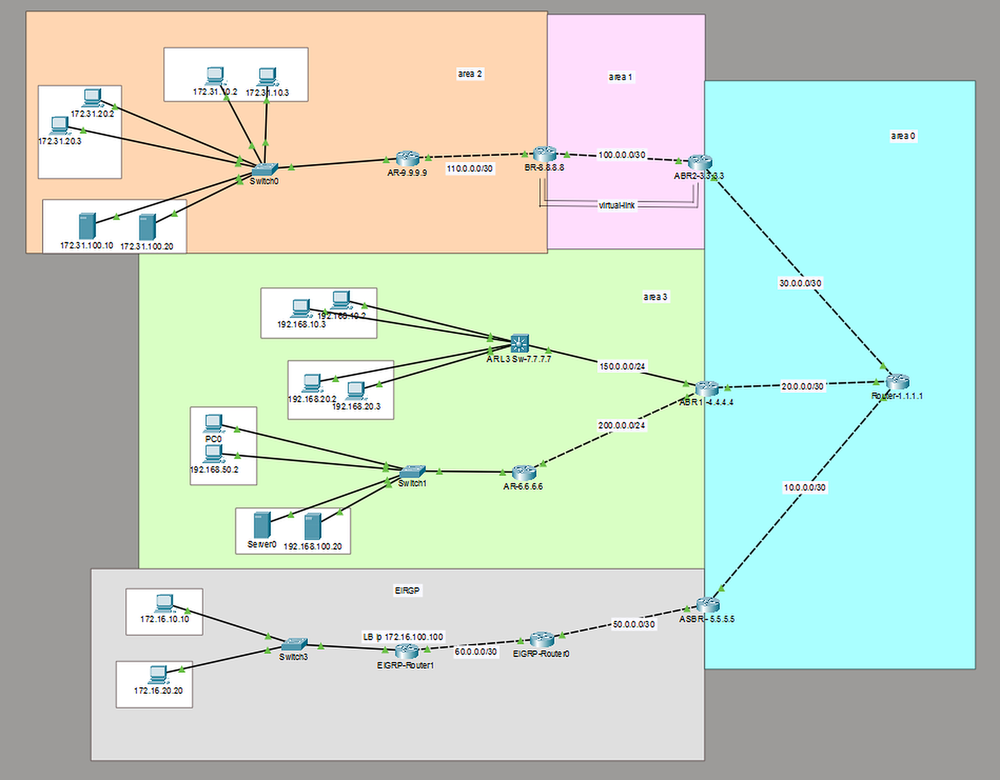
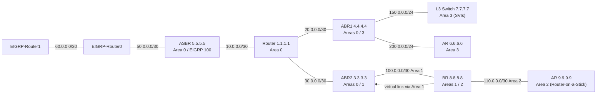

# Multi-Area OSPF with EIGRP Redistribution: Cisco Packet Tracer Lab

A hands-on routing lab that combines **multi-area OSPF**, an **EIGRP** domain redistributed at an ASBR, **route summarization**, an **OSPF virtual link**, and **Inter-VLAN routing** done two ways (Router-on-a-Stick and SVIs on a Layer 3 switch).

> **Tool:** Cisco Packet Tracer 9.0.0



---

## What This Lab Demonstrates

| Topic | What was implemented |
|---|---|
| Multi-area OSPF | Areas 0, 1, 2 and 3 with two ABRs, a third area border router (BR) and an ASBR |
| Redistribution | EIGRP AS 100 ↔ OSPF process 1 at the ASBR |
| Summarization | EIGRP summary `172.16.0.0/16` (one Type 5 LSA instead of many); inter-area summaries `172.31.0.0/16` and `192.168.0.0/16` |
| Virtual link | BR (8.8.8.8) ↔ ABR2 (3.3.3.3) through Area 1, extending Area 0 to the BR |
| Inter-VLAN routing | Router-on-a-Stick (sub-interfaces) and SVIs on a Layer 3 switch |

---

## Logical Topology



---

## Addressing and Area Design

### Devices

| Device | Router ID | Role | OSPF area(s) |
|---|---|---|---|
| Router-1.1.1.1 | 1.1.1.1 | Backbone (internal) router | 0 |
| ASBR-5.5.5.5 | 5.5.5.5 | ASBR (OSPF ↔ EIGRP) | 0 (+ EIGRP 100) |
| ABR1-4.4.4.4 | 4.4.4.4 | ABR | 0, 3 |
| ABR2-3.3.3.3 | 3.3.3.3 | ABR | 0, 1 |
| BR-8.8.8.8 | 8.8.8.8 | Acting ABR (connected to Area 0 through the virtual link) | 1, 2 |
| AR-9.9.9.9 | 9.9.9.9 | Internal router, Router-on-a-Stick | 2 |
| AR L3 Sw-7.7.7.7 | 7.7.7.7 | Layer 3 switch, SVIs | 3 |
| AR-6.6.6.6 | 6.6.6.6 | Internal router | 3 |
| EIGRP-Router0 / EIGRP-Router1 | n/a | EIGRP routers | EIGRP AS 100 |

### Point-to-point links

| Network | Endpoints | Area |
|---|---|---|
| 10.0.0.0/30 | Router-1.1.1.1 (.1) ↔ ASBR (.2) | 0 |
| 20.0.0.0/30 | Router-1.1.1.1 (.1) ↔ ABR1 (.2) | 0 |
| 30.0.0.0/30 | Router-1.1.1.1 (.1) ↔ ABR2 (.2) | 0 |
| 100.0.0.0/30 | ABR2 (.1) ↔ BR (.2) | 1 |
| 110.0.0.0/30 | BR (.1) ↔ AR-9.9.9.9 (.2) | 2 |
| 150.0.0.0/24 | ABR1 ↔ L3 Switch 7.7.7.7 | 3 |
| 200.0.0.0/24 | ABR1 ↔ AR-6.6.6.6 | 3 |
| 50.0.0.0/30 | ASBR (.1) ↔ EIGRP-Router0 (.2) | EIGRP 100 |
| 60.0.0.0/30 | EIGRP-Router0 ↔ EIGRP-Router1 | EIGRP 100 |

### LAN networks

| Network | Where | Method |
|---|---|---|
| 172.31.10.0/24, 172.31.20.0/24, 172.31.100.0/24 | AR-9.9.9.9 (Area 2) | Router-on-a-Stick |
| 192.168.10.0/24, 192.168.20.0/24 | L3 Switch 7.7.7.7 (Area 3) | SVIs |
| [192.168.50.0/24, 192.168.100.0/24] | Behind AR-6.6.6.6 (Area 3) | [fill in] |
| 172.16.10.0/24, 172.16.20.0/24, 172.16.100.100/32 (loopback) | EIGRP domain | EIGRP 100 |

---

## Key Configurations

> Full per-device configs are in [`/configs`](configs/).

### 1. Redistribution at the ASBR

```
router eigrp 100
 network 50.0.0.0
 redistribute ospf 1 metric 10000 100 255 1 1500
!
router ospf 1
 router-id 5.5.5.5
 log-adjacency-changes
 network 10.0.0.0 0.0.0.3 area 0
 redistribute eigrp 100 subnets
```

### 2. EIGRP summary, one Type 5 LSA into OSPF

On EIGRP-Router0, on the interface facing the ASBR:

```
interface GigabitEthernet0/x
 ip summary-address eigrp 100 172.16.0.0 255.255.0.0
```

The ASBR receives only `172.16.0.0/16` and redistributes that single route into OSPF.

### 3. Inter-area summarization

```
! On BR (8.8.8.8): summarize Area 2
router ospf 1
 area 2 range 172.31.0.0 255.255.0.0

! On ABR1 (4.4.4.4): summarize Area 3
router ospf 1
 area 3 range 192.168.0.0 255.255.0.0
```

### 4. Virtual link (BR ↔ ABR2 through Area 1)

The BR sits between Area 1 and Area 2 and has no interface in Area 0, so it could not pass inter-area routes along. The virtual link logically extends Area 0 to it.

```
! On BR (8.8.8.8)
router ospf 1
 area 1 virtual-link 3.3.3.3

! On ABR2 (3.3.3.3)
router ospf 1
 area 1 virtual-link 8.8.8.8
```

The transit area (Area 1) must be a normal area, not stub or NSSA.

---

## Inter-VLAN Routing

### Router-on-a-Stick (AR-9.9.9.9, Area 2)

```
interface GigabitEthernet0/1
 no shutdown
!
interface GigabitEthernet0/1.10
 encapsulation dot1Q 10
 ip address 172.31.10.1 255.255.255.0
!
interface GigabitEthernet0/1.20
 encapsulation dot1Q 20
 ip address 172.31.20.1 255.255.255.0
!
interface GigabitEthernet0/1.100
 encapsulation dot1Q 100
 ip address 172.31.100.1 255.255.255.0
```

The switch port facing the router is configured as a trunk (`switchport mode trunk`).

### SVIs on a Layer 3 switch (L3 Sw-7.7.7.7, Area 3)

```
ip routing
!
interface Vlan10
 ip address [gateway] 255.255.255.0
!
interface Vlan20
 ip address [gateway] 255.255.255.0
```

| | Router-on-a-Stick | SVI on L3 switch |
|---|---|---|
| Inter-VLAN traffic path | Goes up the trunk to the router and back | Routed inside the switch |
| Scalability | Limited by a single trunk link | Hardware-speed routing |
| Typical use | Small networks / labs | Campus and enterprise access/distribution |

---

## Verification

| Command | What to look for |
|---|---|
| `show ip ospf neighbor` | All adjacencies FULL |
| `show ip ospf virtual-links` | `OSPF_VL0` up, adjacency FULL (on BR and ABR2) |
| `show ip route ospf` | `O IA` routes for other areas, a single `O E2 172.16.0.0` for the EIGRP domain |
| `show ip ospf database external` | One Type 5 LSA for 172.16.0.0, advertised by 5.5.5.5 |
| `show ip route eigrp` (ASBR) | Only `D 172.16.0.0/16` and `D 60.0.0.0/30` |
| Ping | End-to-end from the Area 2 LAN to the EIGRP domain succeeds |

Screenshots: [`/screenshots`](screenshots/)

---

## Troubleshooting and Lessons Learned

| Problem | Cause | Fix |
|---|---|---|
| `summary-address` rejected under `router ospf` | Not supported on this router model in Packet Tracer | Summarized on the EIGRP side instead (`ip summary-address eigrp`) |
| A router in Area 2 missed inter-area routes | The BR had no interface in Area 0, so it could not pass inter-area routes along | Added a virtual link through Area 1 |
| 172.16.x.x specifics still appeared after summarizing | The ASBR was redistributing both the EIGRP specifics and a static summary route | Removed the static route and static redistribution; summarized in EIGRP |
| Stale Type 5 LSAs lingered after changes | Packet Tracer does not always flush them | Saved and reopened the topology to rebuild the LSDB |

**Takeaways**
- A Null0 summary route must be removed once the specifics are gone, or it will blackhole traffic.
- Summarizing at the EIGRP boundary keeps the OSPF database small.
- Always verify the LSDB (`show ip ospf database`), not just the routing table.

---

## Repository Structure

```
.
├── README.md
├── OSPF_multi_area.pkt        # Packet Tracer project file
├── configs/                   # Running configs, one file per device
├── screenshots/               # Topology + verification output
```

## How to Run

1. Install **Cisco Packet Tracer 9.0.0** (files saved in 9.x may not open in older versions).
2. Open `OSPF_multi_area.pkt`.
3. Wait about a minute for OSPF and EIGRP to converge, then use the commands in [Verification](#verification).

## Skills Demonstrated

`OSPF` · `Multi-area design` · `ABR / ASBR` · `Virtual links` · `EIGRP` · `Route redistribution` · `Route summarization` · `Inter-VLAN routing` · `Layer 3 switching` · `Troubleshooting`

## Author

Jeya Moorthy R · [LinkedIn](www.linkedin.com/in/jeyamoorthy-r)
